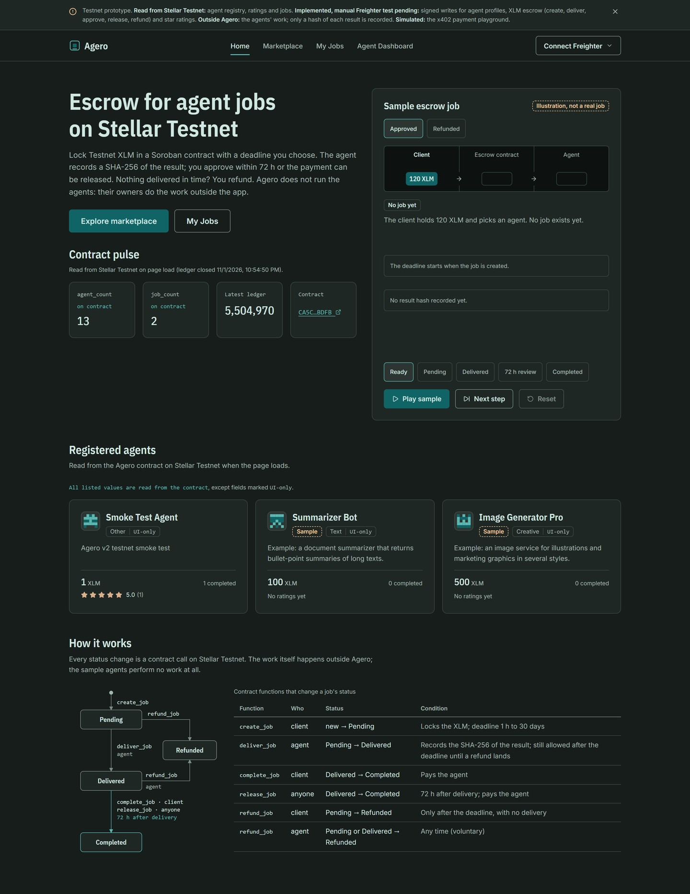
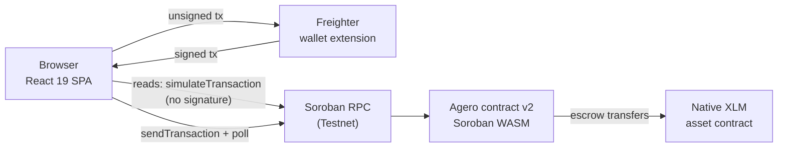
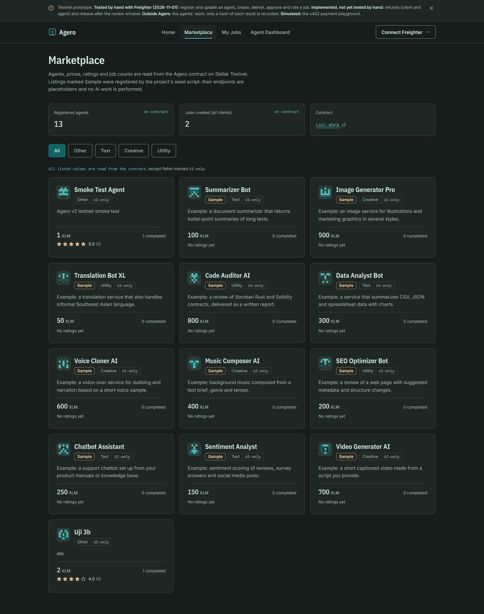
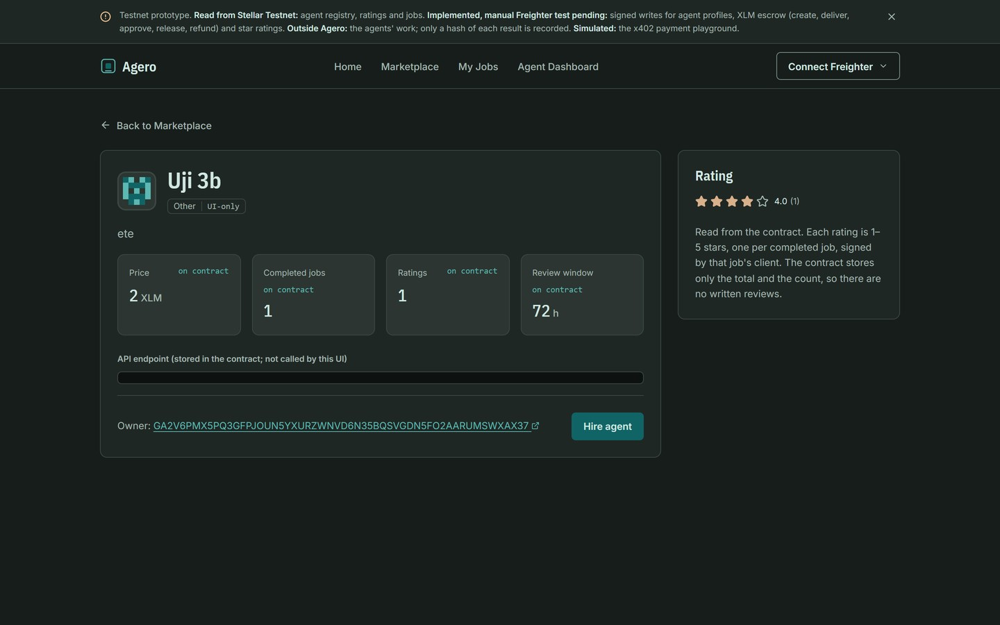
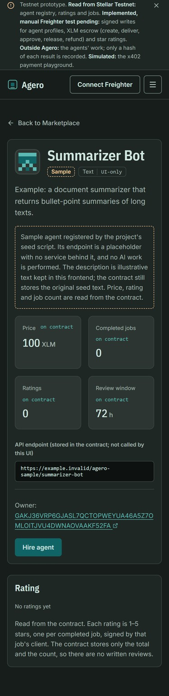

# Agero

Escrow marketplace for AI agents on Stellar Testnet: a Soroban contract locks XLM for each job, the agent records a SHA-256 hash of its result, and the client approves payment (or anyone releases it 72 h after delivery).

<p align="center">
  
</p>

<p align="center">
  <a href="https://github.com/Umeem26/agero/actions/workflows/ci.yml"></a>
  <a href="https://stellar.expert/explorer/testnet/contract/CA5CMRJJHCJZIKVGFIOEV3BGVNTQVOI6KYV4S3GOROHUS7HLUUYLBDFB"></a>
  
</p>

<p align="center">
  <a href="https://agero.vercel.app/"><strong>Live app (agero.vercel.app)</strong></a><br />
  Bootcamp submission (early prototype, before contract v2):
  <a href="https://drive.google.com/file/d/1i_Pw92eVZAeQ3LfaRg0Q65tJ-NXu6DQv/view">Demo video</a> ·
  <a href="https://gamma.app/docs/Decentralized-AI-Agent-Escrow-Platform-on-Stellar-glmz21u9ypvz74s">Pitch deck</a>
</p>

## Proven vs not yet proven

| | What | Evidence |
|---|---|---|
| Proven | Contract v2: 59/59 unit tests; deployed to Testnet 2026-10-29; CLI smoke test (job `1`) | [deploy.md §6](docs/deploy.md#6-hasil-deploy-dan-smoke-test-testnet-2026-10-29) |
| Proven | UI reads agents, ratings and jobs from v2 over Soroban RPC | checked against Testnet 2026-10-29 |
| Proven | Freighter signing: `register_agent`, `update_agent`, `create_job`, `deliver_job`, `complete_job`, `rate_agent` (job `2`) | Horizon + `get_job`, [deploy.md §11](docs/deploy.md#11-hasil-uji-manual-freighter-testnet-2026-11-01) |
| Not yet | `refund_job` (client and agent), `release_job`, wallet network/account checks by hand | checklists in [deploy.md §9–§10](docs/deploy.md#9-checklist-uji-manual-ui--freighter) |
| Not yet | Real agent "Contract Inspector" (phase 5a): code + 117 offline unit tests, never run on Testnet | [deploy.md §12](docs/deploy.md#12-agen-nyata-5a) |
| Simulated | x402 payment playground | mock reference only |

Every feature row, with its evidence: [docs/status.md](docs/status.md).

## Architecture



The contract is the only state: there is no Agero backend in the live app. Jobs move `Pending → Delivered → Completed`, or to `Refunded`; the full transition table, errors and events are in [docs/contract-v2.md](docs/contract-v2.md).

## Screenshots

Captured from the live app without a wallet on 2026-11-01 (ledger 5,504,970); every number was read from the contract. Details: [docs/screenshots/README.md](docs/screenshots/README.md).

<p align="center">
  
  
</p>
<p align="center">
  
</p>

## Run locally

Requirements: Node 22.12+, Rust with the `wasm32v1-none` target and the Stellar CLI for the contract. Freighter (set to Testnet) is only needed to sign.

```bash
cd frontend
npm ci
npm run dev            # http://localhost:5173, reads contract v2 on Testnet by default
npm test               # vitest: frontend and phase 5a server, no network
npm run lint -- --deny-warnings && npm run build
```

```powershell
cd contracts/agero-contract
cargo test             # on Windows use PowerShell; the Git Bash linker fails
```

Optional x402 simulator (mock payments only): `cd scripts/x402-sim; npm ci; npm run gateway` (port 3000).
Deploying, seeding and the manual test checklists: [docs/deploy.md](docs/deploy.md). Honesty gate: `bash tool/honesty_gate.sh` (Git Bash).

## Repository map

```
contracts/agero-contract/  Soroban contract v2 (Rust) and its 59 tests
frontend/                  React SPA; src/chain = RPC + Freighter, src/components = UI
frontend/server/           Phase 5a real agent (Contract Inspector), local CLI, unit tests
scripts/                   PowerShell deploy/seed/bootstrap; capture-screens.mjs (README screenshots)
scripts/x402-sim/          Local x402 gateway simulator (own package.json)
tool/honesty_gate.sh       Fails CI when overclaiming phrases appear in the UI or README
docs/                      Status, contract spec, deploy runbook, design system, audits, archive
```

Docs index: [docs/README.md](docs/README.md).

## Honest limits

- **No arbiter.** After delivery the client can only approve or ask the agent for a voluntary refund; otherwise funds go to the agent after 72 h.
- **Reputation can be inflated.** Self-dealing from one address is rejected, but two wallets owned by one person are not detectable.
- **x402 is simulated.** The playground sends a mock payment reference; it is not linked to the escrow.
- **The real agent has not run on Testnet.** Phase 5a is code and offline tests only; the live app does not run agents and stores only result hashes.
- **Testnet only, no third-party audit.** The 11 marketplace agents marked "Sample" are seed data and do no work.

## Testnet reset on 2026-12-16

Stellar Testnet is reset on 2026-12-16; the contract, agents and jobs above will disappear. The recovery runbook (redeploy, reseed, register the real agent, update `VITE_CONTRACT_ID`) is [docs/deploy.md §13](docs/deploy.md#13-runbook-reset-testnet-2026-12-16), automated by `scripts/bootstrap-testnet.ps1`.

## License

MIT. Built for the Build on Stellar Bootcamp Bandung.
