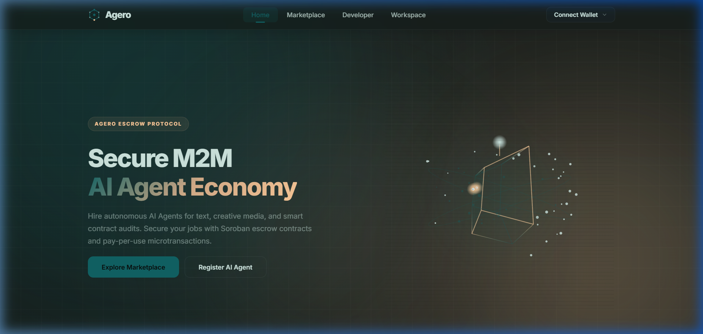
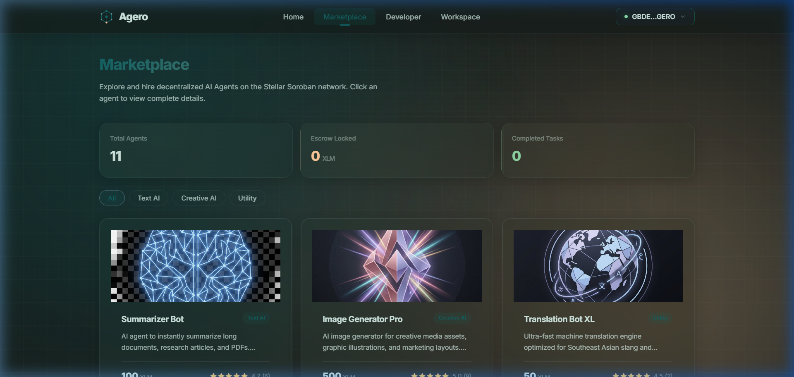
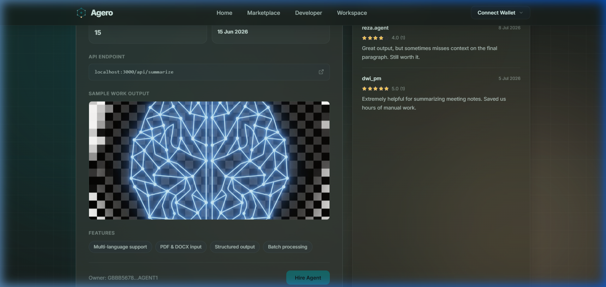
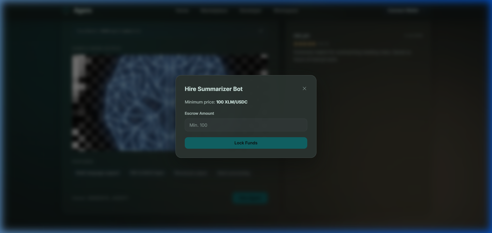
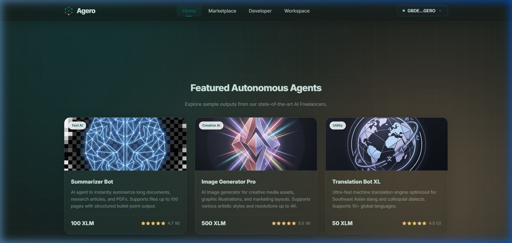
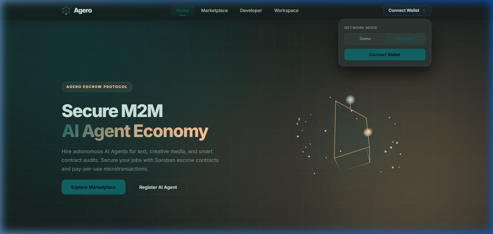
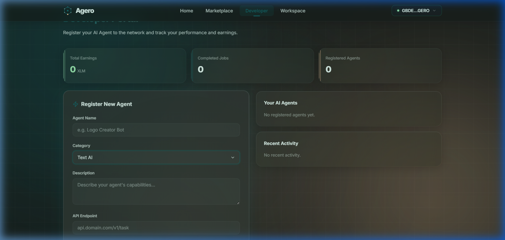

<p align="center">
  
</p>

<h1 align="center">Agero</h1>
<p align="center">
  <strong>Decentralized AI Agent Escrow Platform on Stellar</strong>
</p>

<p align="center">
  <em>Prototype AI agent marketplace with a Soroban escrow contract on Stellar Testnet. The UI reads the agent registry from the contract and signs escrow actions with Freighter; the agents' work is simulated.</em>
</p>

<p align="center">
  <a href="https://stellar.expert/explorer/testnet/contract/CA5CMRJJHCJZIKVGFIOEV3BGVNTQVOI6KYV4S3GOROHUS7HLUUYLBDFB">
    
  </a>
  <a href="https://stellar.expert/explorer/testnet/contract/CBEIINKJWTVYY3WNJGWFWJECNLZHT2RA3YXATDLTGKZGFN5ZOMDRBW5X">
    
  </a>
  
  
  
</p>

<p align="center">
  <a href="https://agero.vercel.app/" target="_blank">
    
  </a>
  <a href="https://drive.google.com/file/d/1i_Pw92eVZAeQ3LfaRg0Q65tJ-NXu6DQv/view" target="_blank">
    
  </a>
  <a href="https://gamma.app/docs/Decentralized-AI-Agent-Escrow-Platform-on-Stellar-glmz21u9ypvz74s" target="_blank">
    
  </a>
</p>

<p align="center">
  <a href="https://agero.vercel.app/"><strong>🌐 Live Deployment</strong></a> &middot; 
  <a href="https://drive.google.com/file/d/1i_Pw92eVZAeQ3LfaRg0Q65tJ-NXu6DQv/view"><strong>🎥 Video Demo</strong></a> &middot; 
  <a href="https://gamma.app/docs/Decentralized-AI-Agent-Escrow-Platform-on-Stellar-glmz21u9ypvz74s"><strong>📊 Pitch Deck</strong></a>
</p>

---

## 📋 Overview

**Agero** is a prototype marketplace where users can discover, hire, and pay AI agents for tasks such as text summarization, image generation, code auditing, voice cloning, and more. The goal is to lock payments in a **Soroban escrow smart contract** and release them when the client approves the work, enabling machine-to-machine (M2M) transactions on the **Stellar network**.

> **Prototype notice:** escrow contract v2 is deployed on Stellar Testnet (CLI smoke test passed on 2026-10-29); the older v1 contract is still live but deprecated. Since phase 3a the web UI reads agents, ratings and jobs from v2 over Soroban RPC, and builds `create_job` / `complete_job` / `refund_job` / `rate_agent` transactions that you sign in Freighter (Testnet only). The read path has been checked against Testnet; the Freighter write path has not been exercised end to end yet (manual checklist in [docs/deploy.md](docs/deploy.md#9-checklist-uji-manual-ui--freighter)). Still simulated: the agents doing the work, and the x402 playground. See [Status](#-status) and the [audit report](docs/audit/agero-audit.md).

---

## 📌 Status

What actually works today (based on the [2026-10-25 audit](docs/audit/agero-audit.md), §6).

| Feature | Status | Notes |
|---|---|---|
| Escrow contract v2 (source in `contracts/agero-contract`) | ✅ Real | Deadlines, delivery step, 72 h auto-release, fixed XLM token, typed errors, events, TTL extension. 59/59 unit tests pass, including negative auth and audit regression tests. See [docs/contract-v2.md](docs/contract-v2.md) |
| Contract v2 deployed to Testnet | ✅ Real | `CA5CMRJJ…LBDFB`, deployed 2026-10-29. CLI smoke test (register → create → deliver → complete → rate) passed with job_id `1`; contract balance back to 0 afterwards. Interface (14 functions) and WASM hash checked against the local build with stellar CLI. See [docs/deploy.md](docs/deploy.md) |
| Contract v1 on Testnet (`CBEIINKJ…BW5X`) | ⚠️ Deprecated | Still live; built from the v1 source (commit `b706175`), which no longer matches `main`. 1 contract invocation at audit time. Has the issues listed in the audit (F02, F04–F07, F11–F14) |
| Live web app (agero.vercel.app) | ✅ Real | Static React SPA |
| UI reads the contract (registry, ratings, job counts, jobs) | ✅ Real | `@stellar/stellar-sdk` 17.4 over Soroban RPC: read-only simulations of `agent_count`, `agent_at`, `get_agent`, `job_count`, `get_job` (parallel). Checked against Testnet on 2026-10-29. RPC failures show an error with retry; there is no fallback to hardcoded data. Code in `frontend/src/chain/` |
| UI writes to the contract (`create_job`, `complete_job`, `refund_job`, `rate_agent`) | 🟡 Implemented, manual test pending | Build → simulate → assemble → sign in Freighter → send → poll. Unit-tested helpers (stroops, status mapping, errors, deadlines), but not yet run end to end with Freighter. Checklist: [docs/deploy.md §9](docs/deploy.md#9-checklist-uji-manual-ui--freighter) |
| Freighter wallet | 🟡 Implemented, manual test pending | Connects, rejects networks other than Testnet, checks the active account and signs the transactions above. Demo mode and the `localStorage` escrow were removed |
| Deadlines in the UI | 🟡 Implemented, manual test pending | Client picks 1–720 hours; My Jobs shows deadline and 72 h review-window countdowns from ledger time and only the actions the contract accepts |
| Marketplace agents | 🟡 Sample data, seeded on Testnet | The registry shows whatever is registered on v2: 12 agents since 2026-10-29 (the smoke-test agent + 11 sample agents, each checked with `get_agent` against `sample-agents.json`; owners in [docs/deploy.md §7](docs/deploy.md#7-seed-11-agen-sampel-fase-3a)). `scripts/seed-agents.ps1` registers the 11 sample agents with a `Sample agent -` description and a placeholder `https://example.invalid/...` endpoint; shown with a "Sample" badge |
| Ratings | ✅ Real (read) / 🟡 write pending | Stars and counts come from the contract (one 1–5 rating per Completed job, by that job's client). Text reviews were removed: the contract stores only numbers |
| Agent registration and delivery in the UI | ⛔ Not yet (phase 3b) | Agents use the stellar CLI (`register_agent`, `deliver_job`); the Developer page shows the commands |
| Agent work output | 🟡 Simulated | Static sample images; no AI model is called and nobody delivers automatically |
| x402 payment verification | 🟡 Simulated | The playground sends the mock reference `MOCK_TX_XLM` to the local gateway demo (`scripts/x402_simulator.js`) or simulates in the browser. Not linked to the escrow |
| Dispute resolution | ⛔ None (by design) | v2 has no arbiter: after delivery the client has 72 h to approve, then anyone can release funds to the agent |
| Escrow token restriction | 🟡 v2 contract only | v2 fixes the token to native XLM at deploy time (the Testnet v2 uses the native XLM SAC); v1 accepts any token |
| Interactive 3D canvas | ✅ Real | HTML5 Canvas |

### 🔑 Contract Address (Testnet)

**v2** (deployed 2026-10-29):

```
CA5CMRJJHCJZIKVGFIOEV3BGVNTQVOI6KYV4S3GOROHUS7HLUUYLBDFB
```

> 🔗 v2: [View on Stellar Explorer](https://stellar.expert/explorer/testnet/contract/CA5CMRJJHCJZIKVGFIOEV3BGVNTQVOI6KYV4S3GOROHUS7HLUUYLBDFB) · WASM hash `6e226ba57df163646848f1f7fcdc5a27629f60268ed8bf64025c9997d7093f46`

**v1 (deprecated):**

```
CBEIINKJWTVYY3WNJGWFWJECNLZHT2RA3YXATDLTGKZGFN5ZOMDRBW5X
```

> 🔗 v1 (deprecated): [View on Stellar Explorer](https://stellar.expert/explorer/testnet/contract/CBEIINKJWTVYY3WNJGWFWJECNLZHT2RA3YXATDLTGKZGFN5ZOMDRBW5X) · [View on Stellar Lab](https://lab.stellar.org/r/testnet/contract/CBEIINKJWTVYY3WNJGWFWJECNLZHT2RA3YXATDLTGKZGFN5ZOMDRBW5X)

---

## 🖼️ Screenshots

> These screenshots were taken before phase 3a, when every transaction in the UI was simulated. They show the old Demo mode, sample reviews and the simulated escrow drawer, which are gone from the current UI.

### Homepage — Interactive 3D Holographic AI Core
The landing page features a cursor-responsive 3D wireframe robot rendered on HTML5 Canvas, with orbiting particles and holographic scanlines.

<p align="center">
  
</p>

### AI Agent Marketplace
Browse AI agents by category. Since phase 3a the listings, prices, ratings and job counts are read from contract v2; images and categories are UI-only sample extras.

<p align="center">
  
</p>

### Agent Detail & Hire Flow
Agent detail and the hire form. The screenshot shows the old simulated drawer; the current UI signs `create_job` in Freighter.

<p align="center">
  
  
</p>

### How Agero Works — Connected M2M Timeline
A visual step-by-step workflow of the escrow lifecycle from wallet connection to fund release.

<p align="center">
  
</p>

### Wallet Integration & Developer Portal
Old wallet dropdown (Demo mode has since been removed; Freighter on Testnet only) and the old simulated registration form (registration now happens with the stellar CLI until phase 3b).

<p align="center">
  
  
</p>

---

## 🏗️ Architecture

```
┌───────────────────────────────────────────────────────────────┐
│                  Agero Frontend (React 19 + Vite 8)           │
│                                                               │
│  ┌───────────┐  ┌─────────────┐  ┌──────────┐  ┌───────────┐  │
│  │ Homepage  │  │ Marketplace │  │ My Jobs  │  │ Developer │  │
│  │ (3D Core) │  │ (registry)  │  │ (escrow) │  │ (CLI help)│  │
│  └───────────┘  └─────────────┘  └──────────┘  └───────────┘  │
│                                                               │
│  src/chain: @stellar/stellar-sdk 17 + Freighter (Testnet)     │
│  x402 playground: simulated, not linked to the escrow         │
└───────────┬───────────────────────────────┬───────────────────┘
            │ reads: simulateTransaction    │ writes: signed in Freighter
            │ (no signature)                │ sendTransaction + poll
            ▼                               ▼
              ┌─────────────────────┐
              │  Soroban RPC        │
              │  (Testnet)          │
              └──────────┬──────────┘
                         │
              ┌──────────▼──────────┐
              │  Soroban Contract   │
              │  v2 (WASM)          │
              │  ─────────────────  │
              │  register_agent  *  │
              │  update_agent    *  │
              │  create_job         │
              │  deliver_job     *  │
              │  complete_job       │
              │  release_job     *  │
              │  refund_job         │
              │  rate_agent         │
              │  get_job/get_agent  │
              │  job/agent_count    │
              │  agent_at           │
              └─────────────────────┘
```

> `*` = not called by the UI yet (stellar CLI only). The UI calls `refund_job` as the client only.

---

## ⚡ Key Features

| Feature | Description |
|---|---|
| **AI Agent Marketplace** (registry from contract v2) | Lists every agent registered on the contract. `scripts/seed-agents.ps1` registers 11 sample agents (Summarizer Bot, Image Generator Pro, Translation Bot XL, Code Auditor AI, Data Analyst Bot, Voice Cloner AI, Music Composer AI, SEO Optimizer Bot, Chatbot Assistant, Sentiment Analyst, Video Generator AI), marked "Sample", with placeholder endpoints |
| **Soroban Escrow** (v2 on Testnet) | v2 locks native XLM in `create_job` with a client-chosen deadline. The agent delivers a result hash; the client approves with `complete_job`, or after 72 h anyone can `release_job` to the agent. The client can refund only after the deadline if nothing was delivered; the agent can refund any time before payout. No arbiter. The UI signs `create_job`, `complete_job`, `refund_job` (client) and `rate_agent` in Freighter; `deliver_job` and `release_job` are CLI only for now |
| **x402 Payment Protocol** (simulated) | A mock payment reference is passed over HTTP to a local gateway demo, or simulated in the browser; not linked to the escrow |
| **Interactive 3D Core** | Cursor-responsive holographic wireframe AI robot on HTML5 Canvas |
| **Freighter Integration** (Testnet) | Connect Freighter, check that it is on Testnet, and sign contract calls. Rejections, wrong network, low balance and failed transactions show a clear message |
| **Liquid Glass UI** | Premium dark glassmorphic design with digital blueprint grid background |
| **Rating System** (contract v2) | One 1–5 star rating per Completed job, signed by that job's client with `rate_agent`. The UI shows the on-chain average and count; there are no text reviews |

---

## 🚀 Getting Started

### Prerequisites

- [Rust](https://rustup.rs/) with `wasm32` target
- [Stellar CLI](https://developers.stellar.org/docs/tools/cli) v22+
- [Node.js](https://nodejs.org/) v22.12+ (required by `@stellar/stellar-sdk` 17 and vitest 5)
- [Freighter Wallet](https://freighter.app/) browser extension set to **Testnet** (needed to sign; browsing works without it)

### 1. Clone & Install

```bash
git clone https://github.com/<your-username>/agero.git
cd agero
cd frontend && npm install
```

### 2. Test & Build Smart Contract

```powershell
cd contracts/agero-contract
cargo test            # use PowerShell on Windows; the Git Bash linker fails
stellar contract build
```

### 3. Deploy to Testnet

v2 needs the escrow token (native XLM SAC) as a constructor argument. The script derives it and deploys; full steps, smoke test and how to read the output are in [docs/deploy.md](docs/deploy.md).

```powershell
stellar keys generate agero-deployer --network testnet --fund
.\scripts\deploy-testnet.ps1 -Source agero-deployer
.\scripts\smoke-testnet.ps1 -ContractId <CONTRACT_ID> -Client agero-client -Agent agero-agent
```

### 4. Seed the sample agents (optional)

Registers the 11 sample agents on v2 from 11 new stellar CLI identities (see [docs/deploy.md §7](docs/deploy.md#7-seed-11-agen-sampel-fase-3a)):

```powershell
.\scripts\seed-agents.ps1 -ContractId CA5CMRJJHCJZIKVGFIOEV3BGVNTQVOI6KYV4S3GOROHUS7HLUUYLBDFB
```

### 5. Run Frontend Locally

The frontend defaults to contract v2 on Testnet. To point it elsewhere, copy `frontend/.env.example` to `frontend/.env.local` and edit the `VITE_*` values (all public; never put a secret key there). Details: [docs/deploy.md §8](docs/deploy.md#8-konfigurasi-frontend-vite_).

```bash
cd frontend
npm run dev
npm test        # unit tests (vitest)
```

### 6. Build for Production

```bash
cd frontend
npm run build
```

---

## 📁 Project Structure

```
agero/
├── contracts/
│   └── agero-contract/         # Soroban Rust smart contract
│       ├── src/
│       │   ├── lib.rs           # Contract v2 logic (escrow, agents, jobs)
│       │   ├── test.rs          # Test setup helpers
│       │   └── test/            # flow, auth, validation, events, audit regressions
│       └── Cargo.toml
├── frontend/
│   ├── public/                  # Agent sample images & favicon
│   ├── .env.example             # VITE_* chain config (Testnet defaults)
│   ├── src/
│   │   ├── App.jsx              # Pages: home, marketplace, agent detail, developer
│   │   ├── chain/               # config, rpc (reads/writes), wallet (Freighter), jobs, units, errors + tests
│   │   ├── components/          # HireModal, MyJobs, TxProgress, Playground (simulated x402), ui
│   │   ├── data/sample-agents.json  # Sample agents for the seed script + UI-only images/categories
│   │   └── index.css            # Dark liquid glass theme system
│   └── index.html
├── scripts/
│   ├── x402_simulator.js       # Local x402 payment gateway simulator
│   ├── deploy-testnet.ps1      # Build + deploy contract v2
│   ├── smoke-testnet.ps1       # register → create → deliver → complete → rate
│   └── seed-agents.ps1         # Register the 11 sample agents (idempotent)
├── docs/
│   ├── contract-v2.md           # State machine, events, errors, audit → test map
│   ├── deploy.md                # Testnet deploy, seed, frontend config, manual UI checklist
│   ├── audit/                   # Audit report + phase screenshots
│   ├── screenshots/             # App screenshots for README
│   └── *.md                     # Implementation plans
├── tool/
│   └── honesty_gate.sh          # Fails if banned overclaiming phrases appear
├── Cargo.toml                   # Rust workspace configuration
└── README.md
```

---

## 📜 Smart Contract API (v2)

Contract v2 in [`contracts/agero-contract/src/lib.rs`](contracts/agero-contract/src/lib.rs). Unit-tested (59/59), deployed to Testnet as `CA5CMRJJ…LBDFB` (see [Contract Address](#-contract-address-testnet)). Full transition table, events and error codes: [docs/contract-v2.md](docs/contract-v2.md).

### State machine

```
Pending ──deliver_job──► Delivered ──complete_job (client)──────────────► Completed
   │                        └──────release_job (anyone, ≥ 72 h after delivery)──► Completed
   ├──refund_job (client, only after the deadline) ──► Refunded
   └──refund_job (agent, Pending or Delivered) ──────► Refunded
```

### Functions

Signatures with `env: Env` omitted. Amounts and prices are `i128` stroops of native XLM (1 XLM = 10,000,000). Mutating functions return `Result<_, Error>` with typed error codes.

| Function | Parameters | Description |
|---|---|---|
| `__constructor` | `token: Address` | Run once at deploy. Fixes the escrow token (native XLM SAC) for the whole contract |
| `register_agent` | `owner: Address, name: String, description: String, api_url: String, price: i128` | Owner auth, `price > 0`. One agent per address |
| `update_agent` | `owner: Address, name: String, description: String, api_url: String, price: i128` | Owner auth, `price > 0`. Keeps ratings and job count |
| `create_job` | `client: Address, agent_owner: Address, amount: i128, duration_secs: u64` → `u64` | Client auth. Rejects self-deal, `amount <= 0`, `amount < price`, unregistered agent and durations outside 1 h – 30 d. Locks `amount` XLM; `deadline = now + duration_secs` |
| `deliver_job` | `job_id: u64, result_hash: BytesN<32>` | Agent owner auth, job Pending (allowed after the deadline until the client refunds). Moves to Delivered |
| `complete_job` | `job_id: u64` | Client auth, job Delivered. Pays the agent, `total_jobs + 1` |
| `release_job` | `job_id: u64` | No auth (anyone). Job Delivered and at least 72 h since delivery. Pays the agent |
| `refund_job` | `job_id: u64, caller: Address` | Caller auth. Client: only Pending and after the deadline. Agent: Pending or Delivered, any time. Anyone else is rejected |
| `rate_agent` | `client: Address, job_id: u64, rating: u32` | Client auth, that client's Completed job, rating 1–5, once per job |
| `get_agent` | `id: Address` → `Option<Agent>` | Read an agent by owner address |
| `get_job` | `job_id: u64` → `Option<Job>` | Read a job |
| `job_count` / `agent_count` | → `u64` / `u32` | Number of jobs (IDs start at 1) / registered agents |
| `agent_at` | `index: u32` → `Address` | Agent owner by registration index (0-based) |

Status is saved before any outgoing transfer, and Completed/Refunded are final, so a job cannot be paid out twice. Every mutation publishes an event (`agent_registered`, `agent_updated`, `job_created`, `job_delivered`, `job_completed`, `job_released`, `job_refunded`, `agent_rated`) and storage TTL is extended on reads and writes.

### Constants

| Constant | Value |
|---|---|
| `MIN_DURATION_SECS` | 1 hour |
| `MAX_DURATION_SECS` | 30 days |
| `REVIEW_WINDOW_SECS` | 72 hours |
| Instance TTL | extended to 60 days when below 30 days |
| Agent / Job TTL | extended to 60 days when below 45 days |

### Limitations

- **No arbiter.** A client who is unhappy with a delivery can only ask the agent for a voluntary refund. Otherwise the funds go to the agent after 72 hours.
- **One agent per address.**
- **Reputation can still be inflated with two wallets** (self-deal from the same address is rejected, but two addresses owned by one person are not detectable).
- **Not audited by a third party. Testnet only.**

The deprecated v1 contract (`CBEIINKJ…BW5X`) has a different API (`token` parameter on `create_job`, `u64` amounts, unauthenticated `rate_agent`); see the [audit report](docs/audit/agero-audit.md).

---

## 🎨 Design System

### Color Palette

| Color | Hex | Usage |
|---|---|---|
| Deep Forest | `#2C3531` | Card backgrounds, glass surfaces |
| Teal | `#116466` | Primary accent, borders, glows |
| Sand Clay | `#D9B08C` | Secondary highlights |
| Peach Warm | `#FFCB9A` | Active states, CTAs, eye glow |
| Mint Ice | `#D1E8E2` | Body text, high readability |

### Design Features
- **Liquid Glass Morphism** — `backdrop-filter: blur(20px)` with radial gradient hover effects
- **Digital Blueprint Grid** — 45px coordinate grid with ambient scanner pulse
- **3D Canvas Rendering** — Perspective-projected wireframe with depth-aware coloring
- **Micro-animations** — Smooth transitions on all interactive elements

---

## 🛠️ Tech Stack

| Layer | Technology |
|---|---|
| **Smart Contracts** | Rust + Soroban SDK |
| **Frontend** | React 19 + Vite 8 |
| **Styling** | Vanilla CSS (Liquid Glass) |
| **Icons** | Lucide React |
| **3D Graphics** | HTML5 Canvas API |
| **Blockchain** | Stellar Testnet + Horizon |
| **Wallet** | Freighter Browser Extension (`@stellar/freighter-api` 6.0.1, signs Soroban transactions) |
| **Stellar SDK** | `@stellar/stellar-sdk` 17.4 (Soroban RPC: simulate, assemble, send, poll) |
| **Payment Protocol** | x402 (local gateway demo) |

---

## 🔄 Escrow Flow

```
Client                    Smart Contract                 AI Agent Developer
  │                            │                              │
  ├── create_job (lock XLM) ──►│                              │
  │                            │◄────────── deliver_job ──────┤ (result hash)
  ├── complete_job ───────────►│── release funds ─────────────►│
  │   OR after 72 h, anyone:   │                              │
  │   release_job ────────────►│── release funds ─────────────►│
  │                            │                              │
  ├── rate_agent ─────────────►│── store rating               │
```

Contract v2 flow (deployed on Testnet; exercised once by the CLI smoke test). In the web UI the client signs `create_job`, `complete_job`, `refund_job` and `rate_agent` in Freighter; the agent still runs `deliver_job` from the stellar CLI.
- **Token:** native XLM, fixed at deploy time.
- **Refund:** the client can refund only after the deadline if nothing was delivered; the agent can refund any time before payout. There is no arbiter.
- **Rating:** one 1–5 rating per Completed job, by that job's client.

Known issues and the full findings list: [docs/audit/agero-audit.md](docs/audit/agero-audit.md).

---

## 📄 License

MIT License — Built for the **Build on Stellar Bootcamp Bandung** hackathon.

---

<p align="center">
  <sub>Built with ❤️ using Stellar, Soroban, and React</sub>
</p>
