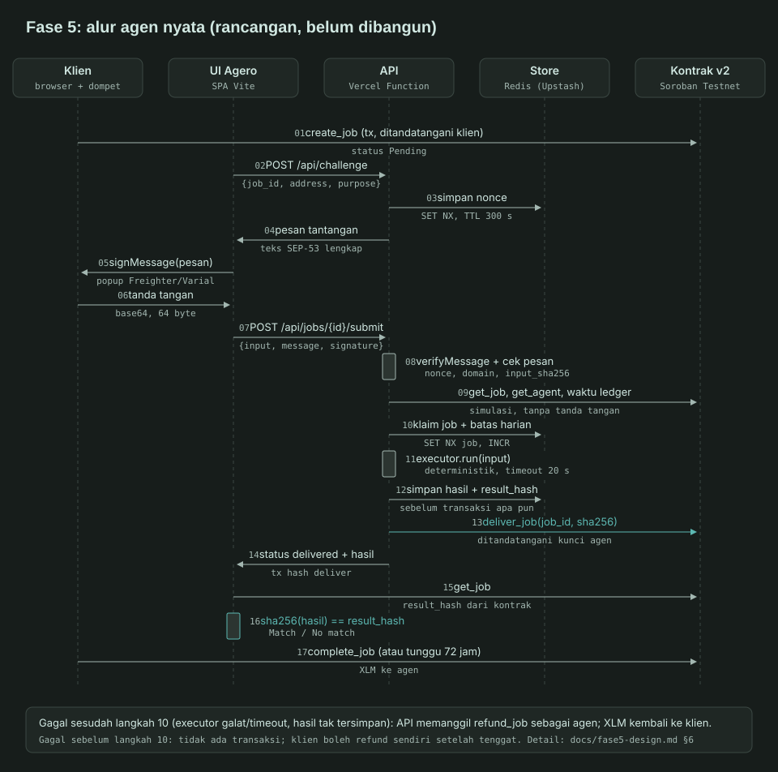

# Fase 5: rancangan agen nyata end-to-end

Status: **rancangan, belum ada kode.** Ditulis 2026-11-01 dari audit read-only. Tidak ada transaksi,
dependensi, konfigurasi, atau secret yang dibuat. Semua klaim teknis dari luar repo diberi sumber di
[§20](#20-sumber) (diakses 2026-11-01). Yang tidak bisa dipastikan ditulis **tidak terverifikasi** dan
dikumpulkan di [§19](#19-tidak-terverifikasi-dan-pertanyaan-terbuka).

Tujuan: satu agen nyata yang mengerjakan job Agero **tanpa mengubah kontrak v2**. Klien membuat job di
chain, UI mengirim input tugas ke fungsi serverless beserta bukti kepemilikan, fungsi memeriksa job di
kontrak, executor bekerja, hasil disimpan, agen memanggil `deliver_job` dengan SHA-256 hasil, dan klien
melihat hasil plus pencocokan hash terhadap `result_hash` yang dibaca langsung dari kontrak.

## 1. Ringkasan keputusan yang direkomendasikan

| # | Topik | Rekomendasi | Alasan singkat |
|---|---|---|---|
| 1 | Bukti kepemilikan | `signMessage` (SEP-53) dari `@stellar/freighter-api` 6.0.1 yang sudah terpasang; verifikasi server dengan `Keypair.verifyMessage` di `@stellar/stellar-sdk` 17.4.0 | Keduanya sudah ada di `node_modules`; tanpa dependensi baru. Pesan memuat domain, jaringan, kontrak, job, hash input, nonce sekali pakai |
| 2 | Platform | Satu Vercel Function Node (handler `fetch` Web standard) di folder `api/` milik root proyek Vercel; diproses **sinkron** dalam satu request, tanpa cron, tanpa `waitUntil` | Hobby: durasi maks 300 s, body 4,5 MB. Sinkron menghindari dependensi `@vercel/functions` |
| 3 | Penyimpanan | Redis Upstash lewat Vercel Marketplace, diakses dengan REST (`fetch`), di balik antarmuka `Store` | `SET NX`/`INCR` cocok untuk idempotensi dan batas harian; Supabase Free di-pause setelah 1 minggu tidak aktif; Blob Hobby hanya 2.000 operasi lanjutan/bulan |
| 4 | Kunci agen | Akun Testnet **baru** khusus agen; secret hanya di env server; passphrase Testnet di-hardcode dan dicek ulang ke RPC | Satu agen per alamat; kebocoran hanya berdampak Testnet |
| 5 | Cek sebelum kerja | Fungsi murni `checkJob` (Pending, agen = kunci server, amount ≥ harga, sisa tenggat ≥ 300 s, penanda tangan = `job.client`, belum diproses) | Bisa diuji tanpa jaringan |
| 6 | Kegagalan | Agen memanggil `refund_job` bila executor gagal setelah job diklaim; klien tidak perlu menunggu tenggat | Kontrak mengizinkan agen refund Pending kapan saja |
| 7 | Anti-penyalahgunaan | 3 job/alamat/hari, 25 job/hari global, input ≤ 1 KiB, timeout executor 20 s, sakelar `AGERO_AGENT_ENABLED` | Spam Testnet gratis; batas global yang benar-benar melindungi kuota |
| 8 | Executor pertama | **Soroban Contract Inspector** (hash WASM, ukuran, fungsi ter-ekspor dari ID kontrak Testnet), deterministik, tanpa LLM | Paling mudah dicek ulang pengguna; SDK sudah punya `getContractWasmByContractId` dan `contract.Spec.fromWasm` |
| 9 | LLM | Hanya adapter di antarmuka yang sama; tidak dipasang | API key belum ada |
| 10 | Kontrak | Tidak diubah. `deliver_job` dan `refund_job` cukup | Lihat §12 |

## 2. Diagram alur



Versi tabel (sama dengan diagram; sumber kebenaran bila keduanya berbeda):

| # | Dari → ke | Aksi | Data / catatan |
|---|---|---|---|
| 1 | Klien → kontrak | `create_job` lewat Hire (jalur yang sudah ada) | Status Pending, `job_id` dari nilai balik |
| 2 | UI → API | `POST /api/challenge` | `{job_id, address, purpose:"submit", input_sha256}` |
| 3 | API → store | Simpan nonce | `SET NX`, TTL 300 s |
| 4 | API → UI | Pesan tantangan | Teks lengkap (format §3.3) |
| 5–6 | UI ↔ dompet | `signMessage(pesan, {address})` | Tanda tangan base64 64 byte |
| 7 | UI → API | `POST /api/jobs/{id}/submit` | `{address, input, message, signature}` |
| 8 | API | Verifikasi tanda tangan dan isi pesan | Nonce dipakai sekali (`GETDEL`) |
| 9 | API → kontrak | `get_job`, `get_agent`, waktu ledger | Simulasi, tanpa tanda tangan |
| 10 | API → store | Klaim job + hitung batas | `SET NX` kunci job, `INCR` penghitung |
| 11 | API | `executor.run(input)` | Timeout 20 s |
| 12 | API → store | Simpan hasil + `result_hash` | **Sebelum** transaksi apa pun |
| 13 | API → kontrak | `deliver_job(job_id, sha256)` | Ditandatangani kunci agen di server |
| 14 | API → UI | Status + hasil | Respons request langkah 7 |
| 15 | UI → kontrak | `get_job` | `result_hash` dibaca dari kontrak, **bukan** dari API |
| 16 | UI | `sha256(hasil) == result_hash` | Alat "Verify delivered file" yang sudah ada, dijalankan otomatis |
| 17 | Klien → kontrak | `complete_job`, atau dilepas oleh siapa saja setelah 72 jam | Jalur yang sudah ada |

## 3. Bukti kepemilikan klien (butir 1)

### 3.1 Hasil pemeriksaan

| Pertanyaan | Hasil | Sumber |
|---|---|---|
| Versi terpasang mendukung `signMessage`? | **Ya.** `@stellar/freighter-api` 6.0.1 mengekspor `signMessage(message, {networkPassphrase?, address?})` dan `signAuthEntry(entryXdr, opts)` | `frontend/node_modules/@stellar/freighter-api/build/@stellar/freighter-api/src/index.d.ts`, `signMessage.d.ts` |
| Bentuk respons | Union dua bentuk: `signedMessage: Buffer \| null` ("V3") atau `signedMessage: string \| null` ("V4"), plus `signerAddress` dan `error?` | `signMessage.d.ts` di paket terpasang |
| Format pesan | Dokumentasi resmi: "Sign an arbitrary string and receive a base64-encoded Ed25519 signature", "Follows SEP-53" | [S1] |
| SEP-53 | Final 1.0.0. Payload = `"Stellar Signed Message:\n"` + pesan UTF-8, di-hash SHA-256 sekali, ditandatangani Ed25519 (64 byte). Spesifikasi tidak mengatur domain, nonce, atau passphrase jaringan | [S2] |
| Verifikasi di server | `Keypair.verifyMessage(message, signature)` ada di SDK 17.4.0 terpasang (SEP-53, prefix sama). Menerima `Uint8Array`; string base64 harus di-decode dulu (string akan melempar `TypeError`) | `frontend/node_modules/@stellar/stellar-sdk/lib/esm/base/keypair.d.ts:140-154`, `keypair.js:16` |
| Runtime Node | SDK 17.4.0 mensyaratkan `node >= 22.12.0`; Vercel menyediakan 22.x, 24.x, 26.x (default 26.x) | `package.json` SDK (`engines`), [S8] |
| Ganti nama | Freighter berganti nama menjadi **Varial** (PR dokumentasi Stellar di-merge 2026-10-29). `docs.freighter.app` dialihkan ke `docs.varialwallet.com`. Paket baru `@stellar/varial-sdk`; dApp yang memakai `@stellar/freighter-api` "keep working"; metode baru hanya terbit di paket baru | [S3], [S4], [S1] |

### 3.2 Dampak ganti nama Freighter → Varial

- **Kode:** tidak ada yang wajib diubah di fase 5. `signMessage` ada di 6.0.1. Migrasi ke
  `@stellar/varial-sdk` adalah dependensi baru, jadi butuh persetujuan dan bukan bagian fase ini.
- **Teks UI:** pesan galat dan label masih menyebut "Freighter". Usul untuk 5c: "Freighter (Varial)"
  di teks baru; mengganti teks lama dibahas terpisah.
- **Risiko:** fitur baru dompet tidak akan tersedia lewat paket lama. Uji manual 2026-11-01
  (`docs/deploy.md` §11) terjadi sesudah tanggal ganti nama, tetapi versi ekstensi yang dipakai tidak
  dicatat (tidak terverifikasi).

### 3.3 Format pesan tantangan

SEP-53 hanya mengikat kunci ke byte pesan. Pengikatan konteks dilakukan oleh isi pesan, yang disusun
**server** dan dikembalikan utuh ke klien (klien tidak menyusun sendiri):

```text
Agero task request v1
Purpose: submit
Domain: agero.vercel.app
Network: Test SDF Network ; September 2015
Contract: CA5CMRJJHCJZIKVGFIOEV3BGVNTQVOI6KYV4S3GOROHUS7HLUUYLBDFB
Job: 7
Client: G...
Input SHA-256: 3f1c...e9
Nonce: 9b1e4c0f2a7d4e61b5a3c8d2f0e1a4b7
Expires: 2026-11-01T12:05:00Z
```

Server memeriksa: tanda tangan valid untuk `Client`; `Client == job.client` (dari `get_job`);
`Purpose`, `Domain`, `Network`, `Contract`, `Job` sama dengan permintaan; `Input SHA-256` sama dengan
SHA-256 input kanonis di body; nonce ada di store dan dihapus atomik saat dipakai (`GETDEL`); belum
kedaluwarsa. Untuk membaca hasil, `Purpose: read` dan baris `Input SHA-256` dihilangkan.

Keterbatasan: SEP-53 menyatakan kepemilikan kunci tidak selalu berarti kendali akun (akun multisig) [S2].
Agero menerima tanda tangan kunci yang alamatnya sama dengan `job.client`; akun dengan master weight 0
tidak didukung.

### 3.4 Alternatif bila `signMessage` gagal di dompet pengguna

| Opsi | Cara | Risiko |
|---|---|---|
| A. Transaksi bukti yang tidak dikirim (pola SEP-10) | Server membuat transaksi `manageData` dengan source akun server dan sequence 0, klien menandatangani lewat `signTransaction` (sudah dipakai). SDK punya `buildChallengeTx`, `readChallengeTx`, `verifyChallengeTxSigners` di modul `webauth` | Butuh keypair server kedua untuk menandatangani tantangan (secret tambahan). Popup dompet terlihat seperti transaksi sungguhan, membingungkan pengguna. Sequence 0 membuat transaksi tidak bisa dikirim, tetapi pengguna tidak tahu itu |
| B. `signAuthEntry` | Menandatangani preimage `SorobanAuthorizationEntry` | Rumit, tidak ada pola server yang sederhana tanpa kontrak verifier; tidak dianjurkan |
| C. Tanpa bukti, hanya cek alamat | Server percaya `address` di body | **Ditolak:** siapa pun bisa mengirim input untuk job orang lain atau membaca hasilnya |

Rekomendasi: A hanya sebagai cadangan bila uji manual 5c menunjukkan `signMessage` gagal.

## 4. Vercel Functions (butir 2)

| Hal | Nilai (Hobby, fluid compute) | Sumber |
|---|---|---|
| Durasi | Default dan maksimum 300 s; lewat batas → 504 `FUNCTION_INVOCATION_TIMEOUT` | [S5] |
| Body request/respons | 4,5 MB; lebih → 413 `FUNCTION_PAYLOAD_TOO_LARGE` | [S5] |
| Memori/CPU | 2 GB / 1 vCPU (default = maks) | [S5] |
| Ukuran bundle | 250 MB tidak terkompresi | [S5] |
| Runtime | Node.js 26.x (default), 24.x, 22.x; pilih via `engines.node` | [S8] |
| Kuota bulanan | 1.000.000 invocation, 4 jam Active CPU, 360 GB-jam provisioned memory | [S6], [S7] |
| Bila kuota habis | "In most cases ... wait until 30 days have passed before you can use the feature again" | [S7] |
| Variabel env | Total 64 KB per deployment; maks 1.000 per environment | [S9] |
| Log runtime | Disimpan 1 jam di Hobby | [S9] |
| Cron | Hobby hanya sekali sehari, presisi ±59 menit. **Tidak dipakai** | [S10] |
| Cold start | Fluid compute: bytecode caching (Node 20+, production saja) dan pre-warming di production. Angka milidetik tidak dipublikasikan | [S11] |
| Penggunaan | Hobby hanya untuk pemakaian non-komersial | [S6] |

**Menambah `api/` ke SPA Vite.** Vercel membuat satu fungsi per file di folder `api/` pada root proyek
Vercel; dianjurkan satu entry yang merutekan semua path (handler `export default { fetch(request) }`)
[S12]. Vite tidak membundel `api/` karena hanya mengikuti `index.html`. Letak folder bergantung pada
**Root Directory** proyek Vercel `agero`, yang tidak terlihat dari repo (tidak ada `vercel.json`;
pertanyaan Q1). Bila Root Directory = `frontend`, struktur usulan:

```
frontend/api/agero.js          # satu fetch handler: /api/agent, /api/challenge, /api/jobs/:id/*
frontend/server/               # modul server, di luar api/ agar tidak jadi fungsi terpisah
  config.js guard.js agent-key.js chain.js check-job.js pipeline.js message.js
  store/{index.js,memory.js,file.js,upstash.js}
  executors/{index.js,contract-inspector.js,llm-adapter.js}
```

`frontend/src/chain/jobs.js`, `hash.js` dan `errors.js` bisa dipakai ulang di server karena murni
(Web Crypto ada di Node 22+). `rpc.js` dan `wallet.js` tidak diimpor di server karena menarik
`@stellar/freighter-api`. `config.js` membaca `import.meta.env` (Vite); server memakai `server/config.js`
sendiri dari `process.env`.

Dev lokal: `vite dev` tidak melayani `/api`. Fase 5a tidak butuh HTTP (skrip CLI). Fase 5b menguji
handler di Vitest dengan objek `Request` biasa; uji end-to-end lewat preview deployment. `vercel dev`
memerlukan Vercel CLI (alat baru, butuh persetujuan).

**Kenapa sinkron, bukan `waitUntil`.** `waitUntil` ada di paket `@vercel/functions` [S11] (dependensi
baru). Pekerjaan satu job diperkirakan < 60 s (§7.2), jauh di bawah 300 s, jadi request `submit`
menunggu sampai selesai. Bila koneksi klien putus, fungsi tetap berjalan karena pembatalan request harus
diaktifkan per rute [S12]. Bila fungsi tetap mati di tengah jalan, pemulihan lazy di §8.3 melanjutkan
dari langkah terakhir yang tersimpan.

**Variabel env (usulan; nama final di 5b):**

| Nama | Isi | Rahasia? |
|---|---|---|
| `AGERO_AGENT_SECRET` | Secret key `S...` akun agen Testnet | **Ya** |
| `AGERO_NETWORK` | Harus `testnet`; nilai lain → fungsi menolak start | Tidak |
| `AGERO_RPC_URL` | Default `https://soroban-testnet.stellar.org`; host di-allowlist | Tidak |
| `AGERO_CONTRACT_ID` | `CA5CMRJJ…LBDFB` | Tidak |
| `AGERO_PUBLIC_ORIGIN` | `https://agero.vercel.app` (baris `Domain` pesan) | Tidak |
| `AGERO_AGENT_ENABLED` | `true`/`false`, sakelar mati | Tidak |
| `AGERO_EXECUTOR` | `contract-inspector@1` | Tidak |
| `AGERO_DAILY_JOB_CAP`, `AGERO_ADDRESS_DAILY_CAP` | 25, 3 | Tidak |
| Kredensial Upstash | Disuntik integrasi Marketplace; nama variabel tidak terverifikasi | **Ya** |
| `VITE_REAL_AGENT_ADDRESS` | Alamat publik agen untuk badge UI | Tidak (masuk bundle) |

## 5. Penyimpanan hasil (butir 3)

### 5.1 Perbandingan

| Kriteria | Supabase Free (Postgres) | Vercel Blob (Hobby) | Redis Upstash Free (pengganti Vercel KV) |
|---|---|---|---|
| Kapasitas | DB 500 MB, egress 5 GB, 2 proyek aktif [S13] | 1 GB, 10.000 operasi sederhana, **2.000 operasi lanjutan**/bulan (upload dihitung) [S14] | 256 MB (kartu harga menulis 250 MB), 500.000 perintah/bulan, request maks 10 MB, 1 database [S16] |
| Idempotensi job | `UNIQUE (contract_id, job_id)` + `INSERT … ON CONFLICT DO NOTHING` | Tidak ada operasi bersyarat yang cocok untuk mesin status | `SET key val NX` |
| Batas laju | Bisa (tabel penghitung), lebih banyak kode | Tidak cocok | `INCR` + `EXPIRE` |
| Kebijakan diam | "Free projects are paused after 1 week of inactivity" [S13] | Kuota habis → Blob tidak bisa diakses 30 hari [S14] | Tidak disebut di halaman harga (tidak terverifikasi) |
| Pembatasan baca ke klien | RLS aktif tanpa policy untuk `anon`; fungsi memakai kunci service | Store privat, dibaca lewat fungsi [S14] | Tidak ada akses langsung dari browser; hanya lewat fungsi |
| Dependensi baru | Tidak wajib bila PostgREST dipanggil dengan `fetch` | `@vercel/blob` (baru) | Tidak wajib bila REST dipanggil dengan `fetch` |
| Status Vercel KV | – | – | "Vercel KV is no longer available"; dipindah ke Upstash Redis Desember 2024 [S15] |

**Rekomendasi: Redis Upstash** lewat Vercel Marketplace. Alasannya: operasi atomik yang dibutuhkan
(`SET NX`, `INCR`, `GETDEL`) tersedia langsung, tidak ada pause mingguan yang tertulis (demo bootcamp
jarang dikunjungi), dan tanpa dependensi baru. Risiko yang belum terverifikasi: persistensi, kebijakan
eviction default, dan kebijakan database gratis yang tidak aktif (Q2, §19). Semua akses lewat
antarmuka `Store` (`claimJob`, `getJob`, `updateJob`, `putNonce`, `takeNonce`, `incrWithTtl`) supaya
pindah ke Supabase cukup menulis satu adapter. Fase 5a memakai `memory` dan `file`.

Kontrol baca: hasil **tidak pernah** dikirim tanpa tanda tangan `Purpose: read` dari `job.client`
(§3.3). Penyimpanan tidak perlu RLS karena tidak bisa diakses dari browser.

### 5.2 Skema data

Kunci Redis (prefiks `agero:v1:`; `{c}` = ID kontrak agar reset Testnet atau redeploy tidak bentrok):

| Kunci | Nilai | TTL |
|---|---|---|
| `job:{c}:{job_id}` | JSON `JobRecord` (di bawah) | 40 hari (> tenggat maks 30 hari + review 72 jam) |
| `nonce:{nonce}` | `{address, job_id, purpose, input_sha256?}` | 300 s; dihapus saat dipakai |
| `rl:addr:{G}:{yyyymmdd}` | penghitung job | 48 jam |
| `rl:global:{yyyymmdd}` | penghitung job | 48 jam |
| `rl:ip:{ip}:{yyyymmddhh}` | penghitung challenge/status | 2 jam |
| `lock:agent-tx` | ID pemegang | 60 s (`SET NX PX`) untuk serialisasi sequence akun agen |

```jsonc
// JobRecord
{
  "schema": 1,
  "contract_id": "CA5C…", "job_id": "7", "client": "G…", "agent": "G…",
  "executor": "contract-inspector@1",
  "input": "{\"contract_id\":\"C…\"}",       // JSON kanonis (kunci terurut, tanpa spasi)
  "input_hash": "hex64",                      // SHA-256 dari input kanonis
  "status": "running",                        // lihat §8.1
  "attempts": 1, "lease_until": 1793534470,   // detik Unix; untuk pemulihan lazy
  "result": "…", "result_media_type": "application/json", "result_filename": "agero-job-7.json",
  "result_hash": "hex64",
  "deliver_tx": "hex64", "deliver_tx_max_time": 1793534530, "refund_tx": null,
  "error_code": null,
  "created_at": 1793534400, "started_at": 1793534401, "delivered_at": null, "updated_at": 1793534401
}
```

Padanan Supabase (bila Q2 memilih Supabase): tabel `agent_jobs` dengan kolom yang sama, `PRIMARY KEY
(contract_id, job_id)`, `CHECK (status IN (...))`, RLS diaktifkan tanpa policy. Apakah kunci service
melewati RLS tidak dibaca ulang hari ini (tidak terverifikasi).

## 6. Kustodi kunci agen (butir 4)

- **Akun:** identity Testnet baru khusus agen nyata (bukan akun A/B dari §11 `deploy.md`), didanai
  friendbot, lalu `register_agent` sekali oleh Umem. Secret dibuat dan disimpan oleh Umem; tidak pernah
  masuk repo, chat, atau variabel `VITE_*` (Vite memasukkan `VITE_*` ke bundle browser;
  `frontend/.env.example` sudah memperingatkan ini).
- **Guard jaringan** (`server/guard.js`, dijalankan sekali per instance sebelum kunci dimuat):
  1. `AGERO_NETWORK === "testnet"`, selain itu lempar galat dan fungsi menjawab 500 `MISCONFIGURED`.
  2. Passphrase **di-hardcode** `Test SDF Network ; September 2015` (nilai Testnet resmi [S17]); tidak
     dibaca dari env.
  3. Host `AGERO_RPC_URL` harus ada di allowlist (`soroban-testnet.stellar.org`).
  4. `rpc.Server.getNetwork()` (ada di SDK 17.4.0, `rpc/server.d.ts:648`) harus mengembalikan
     passphrase yang sama. Ini mencegah env yang menunjuk RPC Mainnet.
  5. Setiap transaksi dibangun dengan passphrase hardcode tersebut. Transaksi yang ditandatangani untuk
     Testnet tidak sah di Mainnet karena passphrase masuk ke hash yang ditandatangani.
- **Tidak pernah tercatat di log:** `server/agent-key.js` memuat `Keypair.fromSecret` sekali dan hanya
  mengekspor `publicKey()` dan `signTransaction(tx)`; string secret tidak disimpan di variabel modul.
  Semua galat yang dicatat melewati `redact()` yang mengganti pola `S[A-Z2-7]{55}` dengan `[redacted]`.
  Dilarang `console.log(process.env)` atau mencatat objek request utuh. Honesty gate diperluas (§13.4).
  Log runtime Hobby hanya bertahan 1 jam [S9].
- **Rotasi:** identitas agen = alamat, satu agen per alamat, dan agen tidak bisa dihapus
  (`docs/contract-v2.md`). Rotasi berarti: matikan sakelar → selesaikan atau refund semua job Pending/
  Delivered milik kunci lama → buat identity baru → `register_agent` → `update_agent` kunci lama dengan
  deskripsi "Retired, replaced by G…" → ganti env dan `VITE_REAL_AGENT_ADDRESS` → nyalakan.
- **Bila bocor:** penyerang bisa (a) `deliver_job` hash sampah ke job Pending agen ini; klien **tidak
  bisa** refund job Delivered, sehingga XLM Testnet dilepas ke alamat agen (yang dikuasai penyerang)
  setelah 72 jam; (b) `refund_job` (merugikan agen saja); (c) `update_agent` untuk mengubah profil;
  (d) menguras saldo XLM Testnet akun agen. Tidak ada dana Mainnet. Tanggapan: sakelar mati, refund
  semua job terbuka secepatnya dengan kunci yang sama (balapan dengan penyerang), rotasi, catat di
  `docs/deploy.md`.

## 7. Verifikasi on-chain sebelum bekerja (butir 5)

### 7.1 `checkJob` (fungsi murni)

Masukan: `job` (`normalizeJob` dari `get_job`), `agent` (`get_agent(agentPublic)`), `ledgerNow`
(waktu tutup ledger terbaru, cara yang sama dengan `fetchLedgerTime` di `rpc.js`), `signer`,
`record` (dari store atau `null`), konfigurasi. Keluaran: `{ok:true}` atau `{ok:false, code}`.

| Urutan | Syarat | Kode galat |
|---|---|---|
| 1 | Job ada | `JOB_NOT_FOUND` |
| 2 | `job.agent === agentPublic` | `WRONG_AGENT` |
| 3 | `signer === job.client` | `NOT_JOB_CLIENT` |
| 4 | `job.status === Pending` | `JOB_NOT_PENDING` |
| 5 | `job.amount >= agent.price` (harga **saat ini**; kontrak hanya mengecek saat `create_job`) | `AMOUNT_BELOW_PRICE` |
| 6 | `job.deadline - ledgerNow >= SAFETY_MARGIN_SECS` (300) | `DEADLINE_TOO_CLOSE` |
| 7 | `record` kosong, atau milik input yang sama dan berstatus bisa dilanjutkan (§8.3) | `ALREADY_SUBMITTED` |

Validasi input executor (skema, ukuran) terjadi **sebelum** `checkJob` sehingga input buruk tidak
pernah memicu klaim atau transaksi.

### 7.2 Margin aman tenggat

Interval ledger diukur dari transaksi uji manual (`docs/deploy.md` §11): ledger 5502051 (11:51:35)
sampai 5502204 (12:04:20) = 153 ledger dalam 765 s = **5,0 s/ledger**. Dokumentasi resmi yang dibaca
tidak menyebut angka ini (tidak terverifikasi dari sumber resmi).

| Komponen (kasus terburuk) | Detik |
|---|---|
| Baca `get_job`, `get_agent`, waktu ledger | 5 |
| Executor (timeout keras) | 20 |
| Simpan hasil | 2 |
| `deliver_job`: simulate + kirim + poll 30 × 1 s | 35 |
| Satu ulangan bila `txBadSeq`/`TRY_AGAIN_LATER` | 35 |
| Selisih jam: waktu ledger terbaru tertinggal ≤ 1 ledger | 5 |
| **Total** | **102** |

`SAFETY_MARGIN_SECS = 300` (≈ 3 × total). Tenggat minimum kontrak 1 jam, jadi job normal selalu lolos;
yang tertolak hanya job yang inputnya dikirim < 5 menit sebelum tenggat. `maxDuration` fungsi 120 s
(> 102 s, < 300 s). Transaksi `deliver_job` diberi `setTimeout(60)` sehingga pasti tidak masuk ledger
lewat dari `deliver_tx_max_time`; ini yang membuat retry aman (§8.2).

### 7.3 Idempotensi

- Kunci unik `job:{contract}:{job_id}` diklaim dengan `SET NX` sebelum executor berjalan. Request kedua
  untuk job yang sama tidak menjalankan executor lagi; ia mendapat status yang ada (atau melanjutkan
  langkah yang macet, §8.3).
- Hasil disimpan sebelum transaksi. Retry **tidak pernah** menjalankan ulang executor; ia memakai hasil
  dan hash yang tersimpan, sehingga hash on-chain selalu cocok dengan hasil yang diserahkan.
- Kontrak sendiri menolak deliver kedua (`deliver_job` hanya dari Pending → `InvalidState`), jadi
  deliver ganda tidak bisa mengubah hash yang sudah tercatat.

## 8. Mode kegagalan (butir 6)

### 8.1 Status `JobRecord`

```
queued → running → result_stored → delivering → delivered
            │             │              └─(InvalidState, job Refunded)→ refunded_by_client
            └─(gagal)─────┴──────────────→ refunding → refunded
rejected   (cek §7 gagal; tidak ada klaim, tidak ada transaksi)
```

### 8.2 Kebijakan: refund oleh agen vs menunggu klien

| | A. Agen memanggil `refund_job` | B. Biarkan klien refund setelah tenggat |
|---|---|---|
| Dana klien | Kembali dalam ~1 menit | Terkunci 1 jam sampai 30 hari |
| Aksi klien | Tidak ada | Harus kembali dan menandatangani refund |
| Biaya | Fee refund dibayar agen (Testnet) | Fee dibayar klien |
| Kode | Satu jalur tambahan + retry | Tidak ada |
| Penyalahgunaan | Klien yang sengaja membuat gagal hanya mendapat uangnya kembali | Sama |
| Kejujuran | Agen mengakui gagal secara eksplisit di chain (event `job_refunded`, `by` = agen) | Tidak ada jejak bahwa agen gagal |

**Rekomendasi A.** Galat permanen (kontrak tidak ditemukan, WASM melebihi batas) → refund langsung.
Galat sementara (RPC timeout) → dua percobaan dengan jeda 2 s dan 4 s di dalam batas 20 s, lalu refund.
Bila transaksi refund sendiri gagal, status tetap `refunding` dan dilanjutkan pemulihan lazy; jaring
pengaman terakhir tetap ada: klien boleh refund sendiri setelah tenggat.

### 8.3 Pemulihan tanpa cron (lazy)

Setiap `submit` ulang dan setiap `GET status` untuk job yang `lease_until` sudah lewat melanjutkan dari
status tersimpan, dengan kunci `lock:agent-tx`:

| Status macet | Langkah lanjut |
|---|---|
| `running` (fungsi mati saat executor) | Executor deterministik dijalankan ulang (hasil belum tersimpan, jadi aman) |
| `result_stored` | Kirim `deliver_job` dengan hash tersimpan |
| `delivering` | `getTransaction(deliver_tx)`: `SUCCESS` → `delivered`; `FAILED` → baca `get_job` lalu putuskan; `NOT_FOUND` dan waktu ledger > `deliver_tx_max_time` → transaksi pasti tidak masuk, bangun ulang dan kirim lagi. RPC menyimpan riwayat ±7 hari [S18] |
| `refunding` | Sama dengan `delivering` untuk `refund_tx` |

### 8.4 Kasus khusus

| Kasus | Penanganan |
|---|---|
| Deliver ganda (dua request bersamaan) | `SET NX` hanya mengizinkan satu pemroses; kontrak menolak deliver kedua |
| Deliver vs tenggat | Margin 300 s membuat deliver masuk jauh sebelum tenggat. Bila tetap kalah (klien refund lebih dulu setelah tenggat) → `InvalidState`; baca `get_job`, status `refunded_by_client`, hasil dihapus |
| Agen me-refund manual dari dashboard saat server bekerja | Deliver gagal `InvalidState` → status `refunded` |
| `txBadSeq` (dua transaksi agen bersamaan) | `lock:agent-tx` menserialkan; bila tetap terjadi: ambil akun ulang, bangun ulang, satu kali ulang |
| `TRY_AGAIN_LATER` | Tunggu 5 s, satu kali ulang |
| Simpan hasil gagal | Tidak ada deliver. Status `running` dengan lease; dilanjutkan request berikutnya |
| Input tidak pernah dikirim | Job tetap Pending; klien refund setelah tenggat (jalur yang ada), atau agen refund manual |

## 9. Anti-penyalahgunaan (butir 7)

| Batas | Angka | Alasan |
|---|---|---|
| Job per alamat klien | 3 / hari UTC | Friendbot memberi 10.000 XLM per akun baru [S17], jadi alamat murah; batas ini hanya rem ringan |
| Job global | 25 / hari UTC (`AGERO_DAILY_JOB_CAP`) | Rem utama. Perkiraan per job: ±30 invocation (challenge, submit, polling), ±30 perintah Redis, ≤ 2 s CPU aktif. 25 job/hari ≈ 22.500 invocation, 22.500 perintah Redis, 25 menit CPU per bulan; di bawah 1 juta invocation, 500 ribu perintah dan 4 jam CPU (perkiraan, diukur di 5b) |
| Challenge | 10 / alamat / jam; 30 / IP / jam | Nonce memakai tulis Redis |
| `GET status` | 120 / IP / jam | Polling UI tiap 3 s selama 2 menit = 40 |
| Ukuran input | ≤ 1 KiB setelah kanonisasi; body ≤ 8 KiB | ID kontrak 56 karakter; jauh di bawah 4,5 MB Vercel |
| WASM yang diambil executor | ≤ 256 KiB (batas Agero) | Batas ukuran kontrak di jaringan tidak terverifikasi |
| Hasil | ≤ 64 KiB | Muat di satu nilai Redis dan satu respons |
| Timeout executor | 20 s (`AbortSignal`) | §7.2 |
| `maxDuration` fungsi | 120 s | §7.2 |
| Sakelar mati | `AGERO_AGENT_ENABLED=false` → semua endpoint tulis 503 `AGENT_DISABLED`; `GET /api/agent` tetap menjawab `enabled:false` | Tanpa mengubah kode; cukup ubah env di dasbor Vercel (perlu redeploy atau tidak: tidak terverifikasi) |

Fee transaksi agen: `deliver_job` di uji manual = 40.725 stroop (0,004 XLM; `docs/deploy.md` §11).
25 job/hari ≈ 0,1 XLM/hari; saldo friendbot cukup bertahun-tahun.

## 10. Executor pertama (butir 8)

### 10.1 Penilaian kandidat (1 = buruk, 3 = baik)

| Kriteria | (a) Testnet Account Report | (b) Soroban Contract Inspector | (c) Peringkas teks LLM |
|---|---|---|---|
| Dapat dicek ulang pengguna | 2: riwayat operasi tetap, tetapi saldo saat itu tidak bisa ditanyakan ulang ke Horizon | 3: hash WASM tetap selama kontrak tidak di-upgrade; pengguna bisa mencocokkan dengan `stellar contract info` atau explorer; executor deterministik bisa diulang | 1: keluaran tidak deterministik |
| Tanpa biaya | 3 | 3 | 1: butuh API key berbayar |
| Relevan dengan Stellar | 3 | 3 (Soroban, cocok dengan proyek kontrak) | 1 |
| Risiko penyalahgunaan | 2: paging Horizon bisa besar, perlu batas halaman | 2: ukuran WASM perlu dibatasi (256 KiB) | 1: prompt injection, biaya per token |
| Kejujuran klaim | 3 | 3: hanya fakta yang dibaca dari RPC | 2: perlu label model dan peringatan |
| Tanpa dependensi baru | 2: perlu Horizon client atau `fetch` | 3: `getContractWasmByContractId` (`rpc/server.d.ts:341`), `contract.Spec.fromWasm` (`contract/spec.d.ts:52`), `funcs()` | 1 |
| **Jumlah** | **15** | **17** | **7** |

**Rekomendasi 5a: (b) Soroban Contract Inspector.** Input `{"contract_id":"C…"}` (Testnet). Keluaran
JSON kanonis (kunci terurut, `\n` di akhir, UTF-8):

```json
{"agent":"G…","executor":"contract-inspector@1","functions":[{"inputs":[{"name":"job_id","type":"u64"}],"name":"get_job","outputs":["option<Job>"]}],"input_sha256":"…","job_id":"7","network":"Test SDF Network ; September 2015","read_at_ledger":5502204,"schema":"agero.contract-inspector/1","target_contract":"C…","wasm_bytes":12345,"wasm_sha256":"…"}
```

`input_sha256` dan `job_id` ada di dalam hasil sehingga `result_hash` on-chain juga mengikat input yang
diminta. Kontrak tidak punya field input, jadi ini satu-satunya cara mengikatnya tanpa mengubah kontrak.
Nama tipe fungsi dari spec tidak diverifikasi formatnya; ditentukan di 5a dengan fixture.

### 10.2 Antarmuka executor

```js
/**
 * @typedef {object} ExecutorSpec
 * @property {string} id            'contract-inspector'
 * @property {number} version       1
 * @property {'deterministic'|'llm'} kind
 * @property {string} label         teks UI, mis. 'Contract Inspector (deterministic, no AI)'
 * @property {string} [model]       wajib bila kind === 'llm', ditampilkan di UI dan di hasil
 * @property {number} maxInputBytes
 * @property {number} timeoutMs
 * @property {(input: unknown) => object} parseInput   lempar RangeError → 400 INVALID_INPUT
 * @property {(input: object, ctx: ExecContext) => Promise<ExecResult>} run
 * @property {(input: object) => {maxCostUsd: number}} [estimate]   wajib untuk llm (gerbang anggaran)
 *
 * @typedef {object} ExecContext
 * @property {AbortSignal} signal
 * @property {{rpcUrl: string, passphrase: string}} network
 * @property {{jobId: string, client: string, agent: string, inputSha256: string, ledgerNow: number}} job
 *
 * @typedef {object} ExecResult
 * @property {Uint8Array} bytes      byte persis yang di-hash dan dikirim ke klien
 * @property {string} mediaType
 * @property {string} filename
 * @property {boolean} permanentFailure   (hanya pada galat) refund tanpa retry
 */
```

Aturan: executor **tidak** menerima kunci agen, store, atau objek request; hashing dan `deliver_job`
dikerjakan pipeline, bukan executor. Registry `executors/index.js` memetakan `AGERO_EXECUTOR` ke spec.
Executor LLM nanti cukup menambah satu file dan satu entri registry; alur, API dan UI tidak berubah
selain menampilkan `kind` dan `model` dari `GET /api/agent`.

## 11. Opsi LLM (butir 9, informasi saja)

Harga resmi per 1 juta token, standar, diakses 2026-11-01. Bukan rekomendasi merek.

| Penyedia | Model (nama di halaman) | Input | Output | Sumber |
|---|---|---|---|---|
| Anthropic | Claude Haiku 5.5 (prompt ≤ 100.000 token) | $0,10 | $0,50 | [S19] |
| Anthropic | Claude Sonnet 5.5 | $2 | $10 | [S19] |
| OpenAI | gpt-5-nano | $0,05 | $0,40 | [S21] |
| OpenAI | gpt-5-mini | $0,25 | $2,00 | [S21] |
| Google | Gemini 2.5 Flash-Lite | $0,10 | $0,40 | [S22] |
| Google | Gemini 3.1 Flash-Lite | $0,25 | $1,50 | [S22] |

Estimasi biaya per job (asumsi: input dibatasi 8 KiB ≈ 2.000 token dengan anggapan ±4 karakter/token,
keluaran dibatasi `max_tokens` 400; token "thinking" dihitung sebagai output pada sebagian model):

| Model | Per job | 750 job/bulan (25/hari) |
|---|---|---|
| Claude Haiku 5.5 | $0,0004 | $0,30 |
| Claude Sonnet 5.5 | $0,008 | $6,00 |
| gpt-5-nano | $0,00026 | $0,20 |
| gpt-5-mini | $0,0013 | $0,98 |
| Gemini 2.5 Flash-Lite | $0,00036 | $0,27 |
| Gemini 3.1 Flash-Lite | $0,0011 | $0,83 |

Batas harian (dua lapis):
1. **Di Agero:** penghitung Redis `llm:usd:{yyyymmdd}` diisi dari `usage` respons × harga; job ditolak
   (`LLM_BUDGET_REACHED`) bila `estimate().maxCostUsd` + pemakaian hari ini > `AGERO_LLM_DAILY_USD_CAP`
   (mis. $0,50). `max_tokens` membatasi biaya per panggilan.
2. **Di penyedia:** Anthropic punya batas belanja bulanan per organisasi dan per workspace yang bisa
   diatur sendiri di Console; saat tercapai request menjawab 400 dengan pesan batas [S20]. Itu bulanan,
   bukan harian, jadi lapis 1 tetap perlu. Fitur budget OpenAI dan Google tidak terverifikasi (halaman
   OpenAI menolak diakses, halaman harga Google tidak menyebut batas belanja).

Executor LLM juga wajib: nama model di hasil dan UI, input klien diperlakukan sebagai data (bukan
instruksi), dan tidak ada akses tool/jaringan dari keluaran model.

## 12. Konfirmasi kontrak tidak perlu diubah (butir 10)

| Kebutuhan | Fungsi kontrak | Penanda tangan | Cukup? |
|---|---|---|---|
| Catat hasil | `deliver_job(job_id, result_hash)` | Pemilik agen job (`job.agent`). Uji manual §11: transaksi `deliver_job` ditandatangani akun B saja (otorisasi source account) | Ya; server menandatangani sebagai akun agen dengan pipeline build → simulate → assemble yang sama |
| Batalkan saat gagal | `refund_job(job_id, caller=agent)` | Agen; Pending atau Delivered, kapan saja | Ya |
| Baca status untuk cek | `get_job`, `get_agent` | Tanpa tanda tangan (simulasi) | Ya |
| Ikat input ke job | (tidak ada) | – | Diakali: `input_sha256` di dalam hasil yang di-hash (§10.1) |

Batasan yang tetap ada:
- **Tanpa arbiter.** Hasil sampah tetap dibayar ke agen setelah 72 jam bila klien diam; klien yang tidak
  puas hanya bisa meminta agen refund sukarela.
- `result_hash` hanya komitmen 32 byte; kontrak tidak menilai isi.
- Input tugas tidak tersimpan di chain; hanya hash-nya yang terikat lewat hasil.
- Reputasi masih bisa dimanipulasi dengan dua wallet; agen tidak bisa dihapus.
- UI hanya memindai 200 job terbaru (`MAX_JOB_SCAN`).
- **Testnet akan di-reset 2026-12-16** (17:00 UTC) [S17]: kontrak, agen dan semua job hilang; perlu
  deploy ulang, ID kontrak baru, `register_agent` ulang, dan env baru (Q7).

## 13. UX dan kejujuran (butir 11)

### 13.1 Alur layar

1. **Marketplace / detail agen:** agen nyata diberi badge **"Real agent · Testnet"** bila
   `owner === VITE_REAL_AGENT_ADDRESS` **dan** `GET /api/agent` menjawab alamat yang sama dengan
   `enabled:true`. Bila API mati: badge "Real agent · offline", tombol Hire nonaktif dengan alasan.
   Agen seed tetap "Sample"; agen pihak ketiga tanpa badge.
2. **Hire** (form yang ada) → `create_job` → modal tidak ditutup, lanjut langkah **"Submit task"**:
   field ID kontrak Testnet, ringkasan "Your wallet will sign a text message. Nothing is sent to the
   network.", tombol "Sign and submit".
3. **Status** dengan langkah: `Queued` → `Running` → `Delivered` / `Failed (refunded)`. Teks status
   diambil dari respons API; langkah deliver menautkan tx hash ke explorer.
4. **Hasil:** JSON diformat, tombol "Download", lalu UI membaca `get_job` sendiri dan menghitung SHA-256
   hasil: chip **"Hash match"** atau **"No match"**, dengan teks "A match means this file is the one the
   agent committed to. It says nothing about quality." Lalu tombol yang sudah ada: Approve & pay /
   Rate.
5. **My Jobs:** job agen nyata yang Pending tanpa input → "Submit task"; Delivered → "View result"
   (minta tanda tangan `Purpose: read`).

Setiap tampilan data punya keadaan loading, kosong, dan galat (standar desain).

### 13.2 Teks yang boleh

- "Real agent · Testnet", "Contract Inspector (deterministic, no AI)", "Reads the contract's WASM from
  Soroban RPC (Testnet)", "Operated by the Agero maintainer", "Hash match", "Testnet only. Test XLM has
  no value."
- Bila nanti LLM: "Summary written by <model id>. It may contain errors."

### 13.3 Teks yang tidak boleh

- "AI", "AI-powered", "smart" untuk executor deterministik.
- "Audit", "security check", "verified contract", "safe", "guaranteed" untuk hasil Inspector.
- "Agero runs", "executed by Agero", "hosted by Agero" (tetap terlarang di gate): agen nyata dijalankan
  pemelihara Agero sebagai pemilik agen, sama seperti pemilik agen lain; README memakai "one demo agent
  operated by the Agero maintainer runs on the project's server".
- "Verified" untuk hasil; yang benar "Hash match".

### 13.4 Perubahan `tool/honesty_gate.sh` (fase 5d)

- Tambah ke `BANNED_PHRASES`: `"AI-powered"`, `"powered by AI"`, `"AI-generated"`, `"security audit"`,
  `"audited by"`, `"verified contract"`, `"result verified"`, `"hash verified"`.
- Tambah target default: `frontend/api`, `frontend/server` (teks respons API ikut diperiksa).
- Tambah blok pemeriksaan kedua (bukan frasa) yang gagal bila: ada `VITE_[A-Z_]*SECRET` di mana pun;
  ada `console.(log|info|warn|error)` yang menyebut `secret`/`AGERO_AGENT_SECRET`/`process.env` di
  `frontend/api` atau `frontend/server`; ada string berpola secret Stellar `S[A-Z2-7]{55}` di file yang
  di-commit.
- "AI agent" **tidak** dilarang karena README memakainya untuk marketplace secara umum.

## 14. Kontrak API

Semua respons JSON `{"ok":true,...}` atau `{"ok":false,"error":{"code","message"}}`. Teks pesan Bahasa
Inggris. Tidak ada cookie atau sesi; otentikasi = tanda tangan SEP-53 per request.

| Metode dan path | Auth | Body / query | Respons sukses |
|---|---|---|---|
| `GET /api/agent` | – | – | `{enabled, agent, network, contract, executor:{id,version,kind,label,model?}, limits:{maxInputBytes, perAddressDaily, globalDaily, safetyMarginSecs}, remainingToday}` |
| `POST /api/challenge` | – (batas laju) | `{job_id, address, purpose:"submit"\|"read", input_sha256?}` | `{message, nonce, expires_at}` |
| `POST /api/jobs/{id}/submit` | Tanda tangan `submit` dari `job.client` | `{address, input, message, signature}` | `{status, result_hash, deliver_tx, result, media_type, filename}` (sinkron) |
| `POST /api/jobs/{id}/result` | Tanda tangan `read` dari `job.client` | `{address, message, signature}` | `{status, result, result_hash, media_type, filename, deliver_tx}` |
| `GET /api/jobs/{id}/status` | – | – | `{status, updated_at, deliver_tx?, refund_tx?}`; tanpa input dan hasil. Memicu pemulihan lazy (§8.3) |

| HTTP | Kode | Kapan |
|---|---|---|
| 400 | `INVALID_INPUT` | JSON rusak, skema input salah, alamat/ID tidak valid |
| 401 | `BAD_SIGNATURE` | `verifyMessage` gagal atau tanda tangan bukan base64 64 byte |
| 401 | `CHALLENGE_INVALID` | Nonce tidak dikenal, sudah dipakai, kedaluwarsa, atau isi pesan tidak cocok dengan request |
| 403 | `NOT_JOB_CLIENT` | Penanda tangan ≠ `job.client` |
| 404 | `JOB_NOT_FOUND` | `get_job` kosong |
| 409 | `WRONG_AGENT`, `JOB_NOT_PENDING`, `AMOUNT_BELOW_PRICE`, `DEADLINE_TOO_CLOSE`, `ALREADY_SUBMITTED` | §7.1 |
| 413 | `INPUT_TOO_LARGE` | Input > 1 KiB atau body > 8 KiB |
| 429 | `RATE_LIMITED` | Batas per alamat/IP (header `Retry-After`) |
| 429 | `DAILY_CAP_REACHED` | Batas global hari ini |
| 500 | `EXECUTOR_FAILED` | Executor gagal; respons memuat `refund_tx` bila refund sudah terkirim |
| 500 | `MISCONFIGURED` | Guard jaringan/env gagal (§6) |
| 502 | `CHAIN_UNAVAILABLE` | RPC tidak bisa dihubungi atau transaksi tidak terkonfirmasi; status tetap tersimpan untuk dilanjutkan |
| 503 | `AGENT_DISABLED` | Sakelar mati |

## 15. Model ancaman

Aset: XLM escrow Testnet, kunci agen, privasi hasil klien, kuota Vercel/Redis, kejujuran klaim.

| Aktor / ancaman | Contoh | Mitigasi |
|---|---|---|
| Peniru klien | Mengirim input atau membaca hasil job orang lain | Tanda tangan SEP-53 dari `job.client` (§3.3); alamat di body tidak dipercaya |
| Replay | Memakai ulang tanda tangan lama | Nonce sekali pakai + kedaluwarsa 5 menit + `Purpose`/`Job`/`Input SHA-256` di pesan |
| Phishing lintas situs | Situs lain meminta pengguna menandatangani pesan Agero | Baris `Domain` diperiksa; pesan hanya berguna untuk satu job dan satu nonce |
| Spammer Sybil | Banyak akun friendbot, banyak job | Batas global harian, batas per alamat/IP, sakelar mati |
| Klien jahat | Input yang memicu galat, WASM raksasa, input panjang | Validasi sebelum klaim, batas ukuran, timeout, galat permanen → refund |
| Kebocoran kunci agen | Log, env salah, repo | §6: redaksi, gate, kunci khusus Testnet, rotasi |
| Salah jaringan | Env menunjuk Mainnet | Passphrase hardcode + `getNetwork()` + allowlist host |
| Agen nakal (pemelihara) | Deliver hasil sampah | Batasan kontrak (tanpa arbiter), diumumkan di UI; hasil berisi fakta yang bisa dicek ulang |
| Gangguan layanan | RPC/Redis/Vercel mati | Status tersimpan, pemulihan lazy, klien tetap bisa refund setelah tenggat |
| Prompt injection (nanti, LLM) | Input berisi instruksi | Input sebagai data, tanpa tool, label model |

## 16. Tabel risiko

| Risiko | Peluang | Dampak | Mitigasi | Sisa |
|---|---|---|---|---|
| Testnet reset 2026-12-16 menghapus kontrak dan agen | Pasti | Tinggi (demo mati) | Rencana redeploy + `register_agent` + env baru; kunci Redis mengandung ID kontrak | Kerja manual setelah reset |
| `signMessage` dompet pengguna tidak memakai SEP-53 / bentuk V3 | Sedang | Sedang | UI menangani `Buffer` dan string; galat jelas "Update your wallet"; cadangan opsi A §3.4 | Tidak terverifikasi sampai uji manual 5c |
| Kuota Hobby habis → fitur dibekukan 30 hari | Rendah | Tinggi | Batas global 25/hari, sakelar mati | Rendah |
| Upstash free dihapus/diarsip saat tidak aktif | Tidak diketahui | Sedang | Antarmuka `Store`; hasil juga bisa diunduh klien | Tidak terverifikasi |
| Fungsi mati di tengah deliver | Rendah | Sedang | Status + tx hash + `maxTime`; pemulihan lazy | Butuh request berikutnya |
| Kebocoran kunci agen | Rendah | Sedang (Testnet) | §6 | Rendah |
| Klaim berlebihan di UI | Sedang | Tinggi (aturan proyek) | §13, gate diperluas | Rendah |
| Ganti nama Varial memecah `@stellar/freighter-api` di masa depan | Rendah | Sedang | Semua panggilan dompet tetap di `wallet.js` | Pantau rilis |
| Cold start lambat | Sedang | Rendah | Sinkron dengan batas 120 s; diukur di 5b | Tidak terverifikasi (angka) |

## 17. Strategi uji (butir 12)

**Unit (Vitest, tanpa jaringan; sudah jadi devDependency):**
- `checkJob`: tabel kasus untuk setiap baris §7.1, termasuk batas tepat `deadline - now == 300`.
- `message.js`: susun/urai pesan; tolak baris berlebih, urutan salah, `Domain`/`Network` lain, nonce
  kedaluwarsa.
- Verifikasi SEP-53: `Keypair.random()` di dalam tes menandatangani; uji tanda tangan base64, `Buffer`,
  pesan diubah satu karakter, alamat lain. Vektor uji SEP-53 resmi [S2] dipakai bila formatnya cocok.
- Mesin status pipeline dengan `Store` memory dan RPC tiruan: sukses, executor gagal → refund,
  `txBadSeq` → ulang sekali, `NOT_FOUND` setelah `maxTime` → kirim ulang, `InvalidState` → baca job.
- Contract Inspector: fixture WASM kontrak Agero hasil `cargo build` di-commit sekali ke
  `frontend/server/__fixtures__/`; keluaran harus sama byte demi byte (snapshot hash).
- Guard: passphrase/host salah → lempar; `redact()` menghapus pola secret.
- Handler (5b): `Request` → `Response` untuk setiap kode galat §14.

**Integrasi Testnet (skrip, dijalankan manual oleh Umem atau atas permintaan):**
`scripts/real-agent-e2e.ps1` memakai stellar CLI: identity klien sekali pakai
`agero-e2e-<yyyymmdd>` didanai friendbot → `create_job` ke agen nyata (1 jam, harga agen) → jalankan
pipeline 5a → cek `get_job` Delivered dan `result_hash` = SHA-256 file hasil → `complete_job`. Skenario
kedua: input kontrak yang tidak ada → `refund_job` oleh agen, saldo klien kembali minus fee. Skenario
ketiga: job untuk agen lain → ditolak tanpa transaksi. Hasil dicatat di `docs/deploy.md` seperti §11.

**Checklist manual Umem (Freighter/Varial, 5c):**
1. Badge "Real agent · Testnet" tampil hanya di agen nyata; agen seed tetap "Sample".
2. Hire agen nyata 1 XLM, 1 jam → popup transaksi → job Pending.
3. "Submit task" → popup **pesan** (bukan transaksi); teks pesan sesuai §3.3 → Queued/Running/Delivered.
4. Chip "Hash match" muncul; unduh file, cocokkan manual lewat "Verify delivered file".
5. Tolak popup pesan → tidak ada perubahan, pesan galat jelas.
6. Kirim ulang dari tab kedua → status yang sama, tidak ada deliver kedua (cek explorer).
7. Ganti akun di dompet lalu "View result" → ditolak `NOT_JOB_CLIENT`.
8. ID kontrak tidak ada → Failed, refund oleh agen, saldo kembali.
9. Jaringan dompet Mainnet → ditolak sebelum tanda tangan.
10. Sakelar mati (env) → tombol nonaktif dengan alasan.
11. Approve & pay lalu Rate seperti biasa.
12. Catat versi ekstensi dompet dan bentuk respons `signMessage`.

## 18. Pembagian fase

| Fase | Isi | Kriteria selesai | Ukuran |
|---|---|---|---|
| **5a** Inti server | `frontend/server/` (config, guard, agent-key, chain, check-job, message, pipeline, store memory/file, executor Contract Inspector + registry), skrip CLI `node frontend/server/cli.mjs --job <id> --input <json>` tanpa HTTP dan tanpa tanda tangan klien (mode lokal tepercaya) | Unit test §17 lulus tanpa jaringan; satu job e2e Testnet Delivered dengan hash cocok + satu refund oleh agen, dicatat di `deploy.md`; tanpa dependensi baru; lint, test, build, cargo test, gate lulus | M: ±700–900 baris termasuk tes, 1–2 sesi |
| **5b** API + tanda tangan + penyimpanan | `frontend/api/agero.js`, challenge/nonce, verifikasi SEP-53, batas laju, store Upstash via `fetch`, pemulihan lazy, `vercel.json` untuk `maxDuration` (perlu persetujuan konfigurasi), env di Vercel oleh Umem | Tes handler untuk semua kode §14; preview deployment menjawab `/api/agent`; skrip uji menandatangani dengan identity sekali pakai dan menyelesaikan satu job lewat HTTP; sakelar mati teruji | M: ±600 baris |
| **5c** UI | `signMessage` di `wallet.js` (V3/V4), langkah Submit task di HireModal, status, penampil hasil + hash match otomatis dari `get_job`, tombol My Jobs, badge | Lint/test/build; checklist §17 dijalankan Umem; tangkapan layar 375 px dan desktop | M: ±400 baris |
| **5d** Dokumen + gate | Baris Status README, `deploy.md` §12 (langkah + hasil), `CLAUDE.md`, perluasan gate §13.4, `docs/contract-v2.md` tidak berubah | Gate baru lulus dan menangkap contoh pelanggaran yang sengaja dibuat lalu dihapus; klaim README sesuai bukti | S |

## 19. Tidak terverifikasi dan pertanyaan terbuka

**Tidak terverifikasi:**
1. Versi minimum ekstensi Freighter/Varial yang memakai SEP-53 di `signMessage`, kapan respons berbentuk
   `Buffer` (V3) vs string (V4), dan apakah versi lama menandatangani tanpa prefix.
2. Versi ekstensi yang dipakai pada uji manual 2026-11-01, dan apakah ekstensi Varial terbaru masih
   menjawab `@stellar/freighter-api` 6.0.1 (PR dokumentasi menyatakan ya [S4]; belum diuji di sini).
3. Upstash Free: persistensi data, eviction default, kebijakan database tidak aktif, nama variabel env
   dari integrasi Marketplace, dan bentuk REST API (tidak dibaca hari ini).
4. Supabase: kunci service melewati RLS (pengetahuan umum, tidak dibaca ulang).
5. Batas ukuran WASM kontrak dan entri ledger di Testnet (dokumen merujuk ke `stellar network settings`,
   tidak dijalankan).
6. Interval ledger 5 s: diukur dari §11, bukan dari dokumen resmi.
7. Angka cold start Vercel (tidak dipublikasikan); diukur di 5b.
8. Apakah perubahan env Vercel berlaku tanpa redeploy.
9. Root Directory dan versi Node proyek Vercel `agero`.
10. Fitur budget/batas belanja OpenAI dan Google; harga OpenAI dibaca dari halaman developer (halaman
    `openai.com/api/pricing` menjawab 403).
11. Asumsi ±4 karakter per token untuk estimasi biaya LLM.
12. Batas laju RPC publik Testnet (tidak disebut di dokumen jaringan).

**Pertanyaan untuk Umem:**
- **Q1** Root Directory proyek Vercel `agero`: `frontend` atau root repo? (menentukan letak `api/`)
- **Q2** Setuju Upstash Redis lewat Vercel Marketplace, atau pilih Supabase?
- **Q3** Siapa yang membuat identity agen nyata (usul: Umem, nama `agero-real-agent`) dan kapan secret
  dimasukkan ke env Vercel?
- **Q4** Harga dan deskripsi on-chain agen nyata (usul: 1 XLM, "Contract Inspector: reads a Testnet
  contract's WASM hash, size and exported functions. Deterministic, no AI.").
- **Q5** Setuju executor pertama Contract Inspector?
- **Q6** Boleh menambah `vercel.json` (hanya `maxDuration`) di 5b?
- **Q7** Rencana setelah reset Testnet 2026-12-16: deploy ulang kontrak dan seed ulang?
- **Q8** Ganti teks UI "Freighter" menjadi "Freighter (Varial)" sekarang atau nanti?
- **Q9** Setuju kebijakan refund otomatis oleh agen saat gagal (§8.2)?
- **Q10** Hasil Inspector berisi data publik; tetap dibatasi hanya untuk klien job (sesuai brief), atau
  boleh publik untuk menyederhanakan 5b/5c?

## 20. Sumber

Semua diakses 2026-11-01. Berkas lokal dirujuk dengan path di teks.

| ID | URL | Dipakai untuk |
|---|---|---|
| S1 | https://docs.varialwallet.com/guide/usingfreighterwebapp (dialihkan dari docs.freighter.app) | `signMessage` base64, "Follows SEP-53", `signAuthEntry` |
| S2 | https://github.com/stellar/stellar-protocol/blob/master/ecosystem/sep-0053.md | Skema SEP-53, status Final 1.0.0 |
| S3 | https://stellar.org/blog/foundation-news/freighter-is-now-varial | Pengumuman ganti nama |
| S4 | https://github.com/stellar/stellar-docs/pull/2956 | `@stellar/varial-sdk`, paket lama tetap jalan, merge 2026-10-29 |
| S5 | https://vercel.com/docs/functions/limitations | Durasi, body, memori, bundle |
| S6 | https://vercel.com/docs/limits/fair-use-guidelines | Kuota bulanan Hobby, non-komersial |
| S7 | https://vercel.com/docs/plans/hobby | Kuota Hobby, perilaku saat kuota habis |
| S8 | https://vercel.com/docs/functions/runtimes/node-js/node-js-versions | Versi Node |
| S9 | https://vercel.com/docs/limits | Env 64 KB, log 1 jam |
| S10 | https://vercel.com/docs/cron-jobs/usage-and-pricing | Cron Hobby sekali sehari |
| S11 | https://vercel.com/docs/fluid-compute | Cold start, `waitUntil`, default fluid |
| S12 | https://vercel.com/docs/functions/runtimes/node-js | Folder `api/`, handler `fetch`, pembatalan per rute |
| S13 | https://supabase.com/pricing | Batas Free, pause 1 minggu |
| S14 | https://vercel.com/docs/vercel-blob/usage-and-pricing | Batas Blob Hobby, store privat |
| S15 | https://vercel.com/docs/redis | Vercel KV dihentikan, pindah ke Upstash |
| S16 | https://upstash.com/pricing/redis | Batas Upstash Free |
| S17 | https://developers.stellar.org/docs/learn/fundamentals/networks | Passphrase, reset Testnet 2026-12-16, friendbot |
| S18 | https://developers.stellar.org/docs/data/apis/rpc/api-reference/methods/getTransaction | Retensi ±7 hari, status `NOT_FOUND` |
| S19 | https://platform.claude.com/docs/en/about-claude/pricing | Harga Claude |
| S20 | https://platform.claude.com/docs/en/api/rate-limits | Batas belanja organisasi/workspace |
| S21 | https://developers.openai.com/api/docs/pricing (dialihkan dari platform.openai.com/docs/pricing) | Harga OpenAI |
| S22 | https://ai.google.dev/gemini-api/docs/pricing | Harga Gemini |
